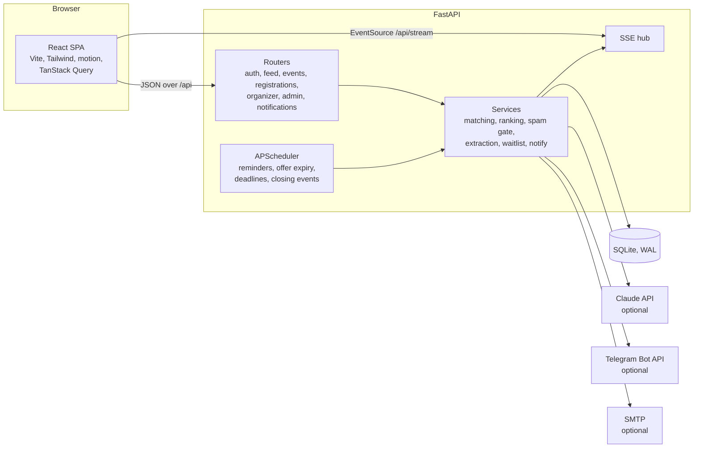

# ShowUp

Every platform helps you find events. ShowUp helps you show up.

ShowUp recommends only the events a student can actually attend (free time, travel, budget, eligibility, interests), explains why each one fits, and then helps them get there: a pass with a leave-by time, reminders, a one-tap "Can't make it" that hands the seat to the waitlist, and QR check-in. Organizers turn a poster into a listing with AI, behind a spam and trust gate, and see predicted vs actual turnout. Pilot city: Coimbatore (₹, IST).

Full brief: [SPEC.md](SPEC.md). Build plan and every decision or deviation: [PLAN.md](PLAN.md).

## Run it

Needs Node 20+ and Python 3.11+. No API keys needed.

```sh
npm install      # also installs the frontend
npm run dev      # API on :8000, web on http://localhost:5173
```

The first `npm run dev` creates `backend/.venv` and installs the Python requirements. With `DEMO_MODE=true` (the default) an empty database is seeded automatically.

| Command | What it does |
|---|---|
| `npm run dev` / `make dev` | Start API and web, both reloading on change |
| `npm run seed` / `make seed` | Reset the database and load demo data (also redraws the sample posters and timetables) |
| `npm test` / `make test` | Backend tests (pytest, 113 tests) |
| `npm run build` | Typecheck and build the frontend |

`make` targets wrap the npm scripts, for systems that have make.

## Environment variables

Copy `.env.example` to `.env` to change any of these.

| Variable | Default | Purpose |
|---|---|---|
| `APP_ENV` | `dev` | `prod` refuses to start with the default `JWT_SECRET` |
| `DEMO_MODE` | `true` | Demo sign-in buttons, sample posters and timetables, the demo panel, auto-seed; seat offers last 2 min instead of 15 |
| `AI_MODE` | `auto` | `auto` uses Claude when a key is set, `mock` never does, `live` requires a key |
| `ANTHROPIC_API_KEY` | empty | Enables live poster and timetable reading and the trust gate's second opinion |
| `ANTHROPIC_MODEL` | `claude-sonnet-5-5` | Model for extraction |
| `JWT_SECRET` | `change-me` | Signs session cookies |
| `DATABASE_URL` | `sqlite:///./showup.db` | Relative paths resolve inside `backend/` |
| `TELEGRAM_BOT_TOKEN`, `TELEGRAM_BOT_USERNAME` | empty | Telegram alerts and poster posting; the bot long-polls in dev |
| `ORS_API_KEY` | empty | Reserved for OpenRouteService travel times (straight-line x 1.4 is used today) |
| `SMTP_HOST`, `SMTP_USER`, `SMTP_PASS`, `SMTP_FROM` | empty | Email alerts; without them emails print to the API console |
| `WAITLIST_CONFIRM_MINUTES` | `15` | How long a promoted waitlister has to confirm (2 in demo mode) |
| `FRONTEND_ORIGIN`, `PUBLIC_URL` | `http://localhost:5173` | CORS origin, and the base for links in emails and Telegram |

Optional semantic matching: `backend/.venv/Scripts/python -m pip install -r backend/requirements-ml.txt` (Windows; `backend/.venv/bin/python` elsewhere). It's a large download (PyTorch); without it, keyword and synonym matching is used. `/api/health` shows which is active.

## Demo accounts

Password for all: `demo1234`. The sign-in screen has one-tap buttons.

- `student@demo.app` (Asha): free Sat 2 to 6 PM and Sun 9 AM to 1 PM, likes AI, Python, hackathons, ₹200 budget, 20 km from Gandhipuram
- `organizer@demo.app`: Coimbatore AI Club (trusted)
- `neworg@demo.app`: QuickCareers Hub (new organizer; owns the spam examples)
- `admin@demo.app`
- `student1@demo.app` to `student30@demo.app`: generated students with varied interests and free time

Seeded dates are relative to the day you seed, so the demo is always upcoming.

## Demo script (3 minutes)

Settings → Demo panel (or `/demo`) has one-tap helpers and account switching.

1. **Free time.** Sign in as the demo student. Calendar → Import timetable → "B.Tech IT, Year 3". The image is read, free hours fill in left to right, the review banner appears, and the pill goes from 4 to 12 events.
2. **Feed.** Home shows AI Workshop with its reasons ("Fits your Saturday 2 to 6 PM gap", "Matches your interests in AI and Python"). Almost shows the ML Hackathon: "Runs until 5 PM, you're free until 1 PM on Sunday."
3. **Poster to listing.** Switch to the organizer. New event → sample "AI Workshop: Prompt to Product". The end time is marked "Check this"; confirm it. The trust check says "Looks good" and the reach preview counts the students who fit. Publish.
4. **Alert and register.** Back as the student, a toast arrives: "A seat that fits your Saturday". (Or Demo panel → Publish AI Workshop now.) Tap View → Register: ring, check, confetti, and the pass with QR and "Leave by …".
5. **Spam.** As the organizer, upload the "GUARANTEED INTERNSHIP" sample. Publishing is blocked with clear reasons, and an appeal is possible.
6. **Waitlist.** Demo panel → Release a seat. The student gets "A seat just opened up" and confirms from the toast.
7. **Turnout.** As the organizer, open the event: predicted vs actual, likelihood per registrant. Check-in → scan the student's QR (or type the code under it). The count goes up.

## Architecture



- `backend/app/services/matching.py` runs the hard filters (SPEC 5.2) and `ranking.py` the score and template reasons (5.3, 5.4). `feed.py` caches each user's evaluated feed for 30 s.
- `spam.py` is the trust gate (5.6). `listing.py` covers forms, duplicates, publishing and reach preview.
- `extraction.py` handles live and mock AI with Pydantic validation, one retry and caching by file hash (6.1 to 6.5).
- `registration.py` covers seats, the waitlist and promotion under a per-event lock (5.9). `showup_score.py` has likelihood and leave-by (5.7, 5.8).
- `notify.py` holds the alert rules and channels (5.5). `jobs.py` runs the scheduled work.
- On the frontend, pages live in `frontend/src/pages`. The calendar paint grid is in `components/calendar`, the register animation and pass in `components/attendance`, and the design tokens in `src/styles/index.css`.

## Quality checks

- **Backend:** `npm test` runs 113 pytest tests: filters, ranking, reasons, every spam rule and the 29/30/59/60 thresholds, extraction validation and retry, notification caps, quiet hours, pause and dedupe, waitlist promotion (including concurrent cancels), leave-by and reminders, likelihood bounds and monotonicity, check-in, Telegram flows, timetable gaps.
- **Accessibility:** axe-core (WCAG 2.1 AA) passes on 10 key screens in light phone, light desktop and dark desktop. Focus rings are visible, tap targets are 44 px, and reduced motion is respected.
- **Performance** (production build, phone, 4x CPU slowdown): LCP 1.0 to 1.24 s on 4G (9 Mbps, 85 ms RTT), and 1.75 to 1.98 s on Lighthouse's slow profile (1.6 Mbps, 150 ms). First-load JS is about 126 KB gzipped, and the QR scanner (100 KB) loads only on the check-in screen. The calendar paints with no long tasks, and a 500-event feed ranks well under 50 ms.

### Manual smoke checklist (frontend)

- [ ] Onboarding: hero → account → interests → area/distance/budget → timetable or paint → done check → Home count-up
- [ ] Calendar: drag-paint a rectangle, refresh, still there. Presets, "This week only", keyboard (arrows, Space, Shift+arrows)
- [ ] Timetable import fills in left to right and shows the review banner
- [ ] Feed shows reasons; swipe left hides with Undo; Almost shows the clash line
- [ ] Register animation completes and the pass opens; Can't make it releases the seat
- [ ] Organizer poster flow: "Check this" fields, live trust check and reach, publish / blocked / appeal
- [ ] Check-in by QR and by code; the event page counts update
- [ ] Offline banner appears with the network off; unknown URLs show "This page doesn't exist"

## Known limitations

- **Show-up likelihood is a transparent rule-based planning estimate**, not a trained model, and is labelled as such.
- **Mock vs live AI:** mock mode recognises only the sample posters and timetables. Any other upload opens the manual form or the paint grid. Live mode needs `ANTHROPIC_API_KEY`.
- **The spam gate is a first line of defence.** Rules plus an optional AI opinion can be fooled, so reports and the admin queue back it up.
- **Interest matching:** without the optional embedding model it uses keywords and synonyms, which miss loosely related topics.
- **Travel time** is straight-line distance x 1.4 at 22 km/h city speed, not live traffic.
- **Single-process pilot:** the feed cache, SSE hub and waitlist locks live in memory, so run one API worker. SQLite is fine for a pilot, not for a city-scale launch.
- **Scale of the demo data:** reach preview shows small numbers with 31 seeded students.
- **Telegram webhooks:** the bot long-polls in development. Set a webhook for production (see PLAN.md).

## Roadmap

Teammate matching for hackathons, Google Calendar free/busy import, WhatsApp alerts, Tamil and English poster reading, smarter ranking from real pilot attendance data, payments, native apps, more cities.
